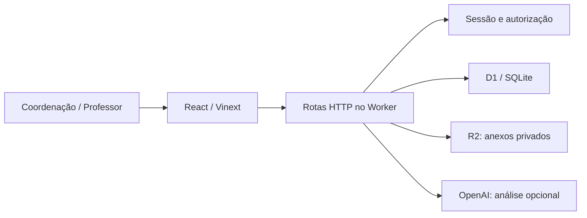

# Arquitetura técnica

## Componentes

`app/page.tsx` concentra a interface principal. `app/team-panel.tsx` gerencia a equipe. `app/lib/auth.ts` implementa autenticação; `access.ts`, autorização; `model.ts`, cálculo de notas e leitura de CSV. `app/api/*/route.ts` contém as rotas. `db/schema.ts` descreve o esquema Drizzle, mas as APIs usam SQL parametrizado diretamente. `drizzle/` versiona as migrações. `worker/`, `lib/` e `scripts/` incluem infraestrutura do starter Sites e Cloudflare. Não remova `lib/` ao empacotar: o Worker depende dela.

## Banco atual

| Tabela | Responsabilidade |
|---|---|
| users | Conta, e-mail único, nome, hash de senha e de recuperação |
| sessions | Hash do token de sessão, usuário e expiração |
| memberships | Professor ligado a um coordenador, ativo/suspenso |
| invitations | Convite por e-mail, hash do token, validade e uso |
| attempts | Contadores de tentativas e cotas |
| records | Dados escolares tipados por kind, em JSON |

`records` possui `id`, `owner`, `kind`, `data`, `version`, `updated` e `identity`. `owner` identifica o coordenador responsável pela equipe. Um professor só pode ter uma associação em `memberships`.

- `class`: nome, alunos `{id,name,number}` e `teacherIds`.
- `exam`: título, disciplina, data, `classIds`, questões e gabarito.
- `submission`: avaliação, turma, aluno, respostas, notas, feedback, anexos, confirmação e versão do gabarito; inclui autor inicial e último revisor.
- `file`: metadados do objeto em R2, turma, avaliação e autor do upload.

Uma avaliação pode abranger várias turmas. Uma turma pode ter vários professores. Cada aluno pode realizar várias avaliações; há no máximo uma correção por par avaliação/aluno dentro da equipe. A identidade única é a serialização JSON `[examId,studentId]`. Referências em JSON são verificadas no servidor; não têm integridade referencial via chaves estrangeiras próprias.

## APIs

Todas as mutações exigem origem válida. Rotas protegidas determinam equipe e papel pela sessão, nunca por um `owner` fornecido pelo navegador.

| Rota | Operações |
|---|---|
| GET/POST /api/auth | Sessão, cadastro, login, logout e recuperação |
| GET/POST /api/team | Equipe, convite, aceite, revogação, suspensão e vínculos |
| GET/POST /api/data | Leitura geral e gravação de turma, avaliação e correção |
| GET /api/results | Correções de um aluno, com cursor e até 100 por página |
| GET/POST /api/files | Download autorizado e upload multipart |
| POST /api/analyze | Extração/sugestões por IA, sem confirmação automática |

Exemplo: `/api/results?studentId=ID&limit=25`. A resposta traz `rows` e `nextCursor`; use `after=CURSOR` na página seguinte. O filtro de acesso do professor é aplicado antes do limite. A rota devolve correções armazenadas, não um relatório recalculado de notas.

## Consistência e desempenho

Atualizações de registros usam `version` para detectar conflito. Mudar o gabarito invalida a confirmação anterior no cálculo dos resultados. Não existe histórico imutável completo nem revisão por questão com atribuição individual.

Índices: equipe/tipo; identidade única da correção; equipe/data de atualização; índice parcial B-tree de equipe/aluno/ID para correções. A migração 0003 contém correção manual da sintaxe de índice de expressão gerada pelo Drizzle. Revise o SQL em futuras migrações, especialmente a expressão `json_extract(data, '$.studentId')`.

O dashboard consulta `/api/data` a cada 10 segundos com a aba visível e calcula indicadores na interface. A busca paginada existe no backend, mas ainda não substitui esse fluxo. Escala maior requer normalização, consultas direcionadas e agregação no servidor. Consulte o relatório de desempenho para os limites das medições.

## Arquivos e segredos

R2 armazena bytes; D1 guarda metadados. O download verifica equipe e turma. A chave OpenAI deve existir somente no ambiente do Worker. Não há senha de banco D1 no código: o Worker recebe o binding `DB`; o armazenamento usa `BUCKET`. Credenciais Cloudflare são configuradas fora do repositório.
